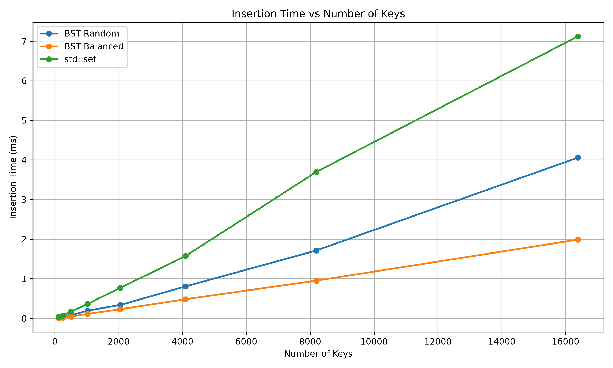

# An Introduction to Applied Dendrology

A C++ implementation and empirical analysis of Binary Search Trees (BSTs) developed for **Assignment III – Task 1: An Introduction to Applied Dendrology** from the *Tree Museum* coursework.

This project investigates how insertion order affects the structure and performance of Binary Search Trees.

---

## Problem Description

The assignment requires implementing a binary tree container and empirically comparing the cumulative running times of inserting large sets of keys into:

1. A Binary Search Tree using a random insertion order.
2. A Binary Search Tree using a best-case insertion order that produces a perfectly balanced tree.
3. A library implementation using `std::set`.

The actual heights of the generated trees must also be measured and compared with the theoretical expectations.

---

## Project Structure

```text
Assignment-III_Tree_museum/
│
├── data/
│   └── benchmark.csv
│
├── report/
│   ├── graph.py
│   ├── insertion_time.png
│   └── tree_height.png
│
├── src/
│   ├── BST.h
│   ├── BST.cpp
│   ├── Benchmark.h
│   ├── Benchmark.cpp
│   └── main.cpp
│
├── Utils/
│   ├── Utils.h
│   └── Utils.cpp
│
├── README.md
└── .gitignore
```

---

## Building

Compile using:

```bash
g++ src/*.cpp Utils/*.cpp -o benchmark
```

---

## Usage

Run the benchmark:

```bash
./benchmark
```

On Windows:

```bash
./benchmark.exe
```

The program:

1. Generates benchmark datasets.
2. Builds BSTs using random insertion order.
3. Builds BSTs using balanced insertion order.
4. Builds a `std::set`.
5. Measures insertion times.
6. Measures resulting tree heights.
7. Saves benchmark results to `data/benchmark.csv`.

Generate graphs with:

```bash
py -3.13 report/graph.py
```

---

## Dataset

The benchmark dataset is provided in:

```text
data/benchmark.csv
```

Each record contains:

- Tree size
- BST insertion time (random order)
- BST insertion time (balanced order)
- `std::set` insertion time
- BST height (random order)
- BST height (balanced order)

The dataset is used to generate all graphs included in the report.

---

## Binary Search Tree Implementation

### Node Structure

Each node stores:

```cpp
struct Node
{
    int key;

    Node* left;
    Node* right;
};
```

### Insertion

Insertion follows standard BST rules:

```text
key < node->key  → left subtree
key > node->key  → right subtree
```

Duplicate keys are ignored.

### Height Calculation

Tree height is computed recursively:

```text
height(node)
=
1 + max(
    height(left),
    height(right)
)
```

### Memory Management

All nodes are released using recursive postorder traversal:

```cpp
destroy(left);
destroy(right);
delete node;
```

ensuring correct memory cleanup and no leaks.

---

## Balanced BST Construction

A perfectly balanced BST cannot be obtained by inserting keys in sorted order.

Instead, the insertion sequence is generated recursively:

1. Insert the middle element.
2. Insert the middle of the left half.
3. Insert the middle of the right half.
4. Continue recursively.

Example:

Sorted keys:

```text
1 2 3 4 5 6 7
```

Balanced insertion order:

```text
4 2 1 3 6 5 7
```

Resulting tree:

```text
        4
      /   \
     2     6
    / \   / \
   1   3 5   7
```

This construction produces the minimum possible height.

---

## Complexity Analysis

### Binary Search Tree

#### Insertion

Average case:

```text
O(log n)
```

Worst case:

```text
O(n)
```

---

### Balanced BST

The generated insertion order produces a balanced tree whose height remains close to:

```text
O(log n)
```

Insertion therefore behaves like:

```text
O(log n)
```

for all practical operations.

---

### std::set

`std::set` is typically implemented as a self-balancing Red-Black Tree.

Insertion complexity:

```text
O(log n)
```

---

## Expected Graph Behavior

The theoretical complexity predicts the following:

- Insertion time should increase as the number of keys increases.
- Balanced BST insertion should produce shorter search paths than random BST insertion.
- Balanced BST height should remain close to `log₂(n)`.
- Random BST height should grow significantly faster.
- `std::set` should maintain logarithmic behavior due to automatic balancing.

The generated graphs should reflect these expectations.

---

## Benchmark Configuration

### Tree Sizes

```text
127
255
511
1023
2047
4095
8191
16383
```

These values satisfy:

```text
n = 2^m − 1
```

which allows perfectly balanced binary trees to be constructed.

### Repetitions

Each benchmark configuration is averaged over:

```text
20 runs
```

---

## Benchmark Results

| Keys | BST Random (ms) | BST Balanced (ms) | std::set (ms) | Random Height | Balanced Height |
|------:|---------------:|------------------:|--------------:|--------------:|----------------:|
| 127 | 0.013320 | 0.007175 | 0.033905 | 14 | 7 |
| 255 | 0.030065 | 0.017875 | 0.071975 | 17 | 8 |
| 511 | 0.073115 | 0.042950 | 0.172140 | 19 | 9 |
| 1023 | 0.194540 | 0.111505 | 0.362635 | 22 | 10 |
| 2047 | 0.335515 | 0.228735 | 0.767980 | 24 | 11 |
| 4095 | 0.806045 | 0.482740 | 1.573080 | 27 | 12 |
| 8191 | 1.713650 | 0.951395 | 3.697670 | 30 | 13 |
| 16383 | 4.058660 | 1.987970 | 7.122570 | 32 | 14 |

Because randomization is used when generating insertion orders, exact runtimes and heights may vary slightly between executions.

---

## Graph Methodology

The benchmark graphs visualize both performance characteristics and structural properties.

### Insertion Time Graph

The insertion-time graph compares:

- BST with random insertion order
- BST with balanced insertion order
- `std::set`

Expected behavior:

- Runtime increases as the number of keys increases.
- Balanced BST insertion should require fewer comparisons due to smaller tree height.
- `std::set` should maintain logarithmic behavior but may incur additional balancing overhead.

### Height Graph

The height graph compares:

- BST random insertion
- BST balanced insertion

Expected behavior:

- Balanced BST height should closely follow the theoretical minimum.
- Random BST height should be significantly larger.
- The difference should become increasingly visible as tree size grows.

---

## Generated Graphs

The following graphs were generated directly from `benchmark.csv`.

### Figure 1 – Insertion Time vs Number of Keys



**Observation**

- All structures exhibit increasing insertion times as the number of keys grows.
- Balanced BST insertion consistently outperforms random BST insertion.
- `std::set` is slower because maintaining balance introduces additional work during insertion.

---

### Figure 2 – Tree Height vs Number of Keys


**Observation**

- The balanced BST closely follows the theoretical minimum height.
- Random insertion produces significantly taller trees.
- The difference becomes more pronounced as the number of keys increases.

---

## Findings

### Effect of Insertion Order

Insertion order has a significant impact on tree structure.

Balanced insertion produced trees whose heights matched the theoretical minimum for every tested tree size.

For the largest benchmark:

```text
16383 keys

Balanced Height = 14
Random Height   = 32
```

The randomly constructed BST required more than twice as many levels.

### Effect on Performance

Balanced insertion also reduced insertion times.

For the largest benchmark:

```text
BST Random   ≈ 4.06 ms
BST Balanced ≈ 1.99 ms
```

The shallower structure reduced the average search path during insertion.

### Comparison with std::set

Although `std::set` maintained logarithmic behavior, it exhibited higher insertion times than both BST variants because it performs balancing operations internally. This additional work guarantees logarithmic height regardless of insertion order.

---

## Conclusions

The experimental results confirm that insertion order has a substantial impact on tree structure and performance.

Balanced insertion produced trees whose heights remained close to the theoretical minimum and consistently achieved lower insertion times than randomly constructed BSTs.

The benchmark graphs clearly support the theoretical analysis:

- Balanced trees maintain logarithmic height.
- Random BSTs become significantly taller.
- Shallower trees generally lead to faster insertion performance.

Overall, the results demonstrate why balanced tree structures are important for maintaining efficient search and insertion operations.

---

## Author

**Desire Roslin Dziele**

University of Lodz  
Algorithms and Data Structures