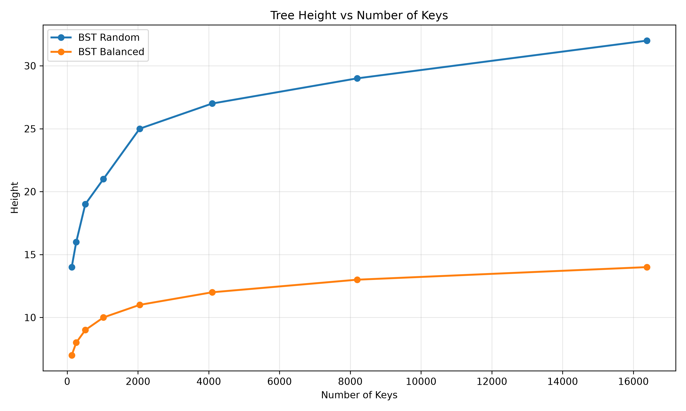
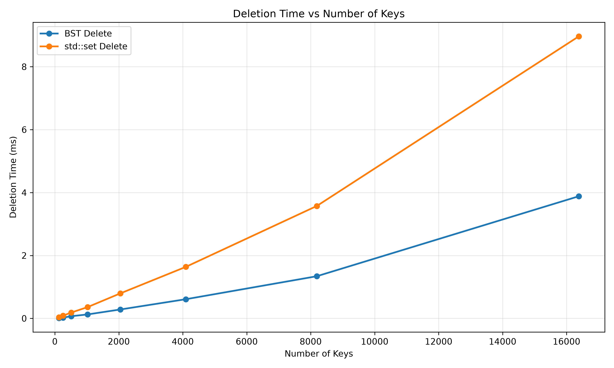

# Tree Museum

A C++ implementation and empirical analysis of Binary Search Trees (BSTs) developed for **Assignment III – Tree Museum** coursework.

This repository currently contains:

- **Task 1 – An Introduction to Applied Dendrology**
- **Task 2 – Pruning the Bushes**

The project investigates how insertion order affects Binary Search Tree structure and performance, and how deletion performance compares between a custom BST implementation and the C++ Standard Library's `std::set`.

---

# Task 1 – An Introduction to Applied Dendrology

## Problem Description

The assignment requires implementing a binary tree container and comparing the cumulative running times of inserting large sets of keys into:

1. A Binary Search Tree using a random insertion order.
2. A Binary Search Tree using a best-case insertion order that produces a perfectly balanced tree.
3. A library implementation using `std::set`.

The actual heights of the generated trees must also be measured and compared against the theoretical expectations.

---

## Project Structure

```text
Assignment-III_Tree_museum/
│
├── data/
│   └── benchmark.csv
│
├── report/
│   ├── graph.py
│   ├── insertion_time.png
│   ├── tree_height.png
│   └── deletion_time.png
│
├── src/
│   ├── BST.h
│   ├── BST.cpp
│   ├── Benchmark.h
│   ├── Benchmark.cpp
│   └── main.cpp
│
├── Utils/
│   ├── Utils.h
│   └── Utils.cpp
│
├── README.md
└── .gitignore
```

---

## Prerequisites

### Compiler

A C++17-compatible compiler is required.

Examples:

- GCC 11+
- Clang 14+
- Microsoft Visual C++ (Visual Studio 2022)

The project was developed and tested using:

```text
g++ (MinGW-w64)
```

### Python

Python is required for graph generation.

Tested with:

```text
Python 3.13
```

Required packages:

```bash
pip install pandas matplotlib
```

### Operating System

Tested on:

```text
Windows 11
```

The benchmark framework uses:

```cpp
QueryPerformanceCounter()
```

from the Windows API for high-resolution timing.

Porting to Linux or macOS would require replacing the timing implementation with `std::chrono`.

---

## Building

Compile using:

```bash
g++ src/*.cpp Utils/*.cpp -o benchmark
```

---

## Usage

Run the benchmark:

```bash
./benchmark
```

On Windows:

```bash
./benchmark.exe
```

The program:

1. Generates benchmark datasets.
2. Builds BSTs using random insertion order.
3. Builds BSTs using balanced insertion order.
4. Builds a `std::set`.
5. Measures insertion times.
6. Measures deletion times.
7. Measures resulting tree heights.
8. Saves benchmark results to `data/benchmark.csv`.

Generate graphs with:

```bash
py -3.13 report/graph.py
```

---

## Dataset

The benchmark dataset is stored in:

```text
data/benchmark.csv
```

Each record contains:

- Tree size
- BST insertion time (random order)
- BST insertion time (balanced order)
- `std::set` insertion time
- BST deletion time
- `std::set` deletion time
- BST height (random order)
- BST height (balanced order)

The dataset is used to generate all graphs included in the report.

---

## Binary Search Tree Implementation

### Node Structure

Each node stores:

```cpp
struct Node
{
    int key;

    Node* left;
    Node* right;
};
```

### Insertion

Insertion follows standard BST rules:

```text
key < node->key → left subtree
key > node->key → right subtree
```

Duplicate values are ignored.

### Height Calculation

Tree height is computed recursively:

```text
height(node)
=
1 + max(
    height(left),
    height(right)
)
```

### Memory Management

All dynamically allocated nodes are released using recursive postorder traversal:

```cpp
destroy(left);
destroy(right);
delete node;
```

This ensures correct memory cleanup and prevents memory leaks.

---

## Balanced BST Construction

A perfectly balanced BST cannot be obtained by inserting keys in sorted order.

Instead, the insertion sequence is generated recursively:

1. Insert the middle element.
2. Insert the middle of the left half.
3. Insert the middle of the right half.
4. Continue recursively.

Example:

Sorted keys:

```text
1 2 3 4 5 6 7
```

Balanced insertion order:

```text
4 2 1 3 6 5 7
```

Resulting tree:

```text
        4
      /   \
     2     6
    / \   / \
   1   3 5   7
```

This construction produces the minimum possible height.

---

## Complexity Analysis

### Binary Search Tree

#### Insertion

Average case:

```text
O(log n)
```

Worst case:

```text
O(n)
```

#### Deletion

Average case:

```text
O(log n)
```

Worst case:

```text
O(n)
```

Deletion requires:

1. Finding the target node.
2. Handling one of three cases:
   - leaf node,
   - one child,
   - two children.
3. Updating pointers while preserving BST ordering.

---

### Balanced BST

Because the insertion order is specifically chosen to maintain balance, the tree height remains close to:

```text
O(log n)
```

Insertion complexity:

```text
O(log n)
```

Deletion complexity:

```text
O(log n)
```

for all practical operations.

---

### std::set

`std::set` is typically implemented as a self-balancing Red-Black Tree.

Insertion:

```text
O(log n)
```

Deletion:

```text
O(log n)
```

The structure remains balanced automatically after every operation.

---

## Expected Graph Behavior

The theoretical complexity predicts:

- Insertion time should increase as the number of keys increases.
- Deletion time should increase as the number of keys increases.
- Balanced BSTs should remain significantly shorter than random BSTs.
- Balanced BSTs should generally require fewer comparisons.
- `std::set` should maintain logarithmic behavior but incur balancing overhead.

The generated graphs are expected to reflect these trends.

---

## Benchmark Configuration

### Tree Sizes

```text
127
255
511
1023
2047
4095
8191
16383
```

These values satisfy:

```text
n = 2^m − 1
```

which allows perfectly balanced trees to be constructed.

### Repetitions

Each benchmark configuration is averaged over:

```text
20 runs
```

---

## Benchmark Results

Because randomization is used when generating insertion orders, exact runtimes and heights may vary slightly between executions.

### Insertion Benchmark Results

| Keys | BST Random (ms) | BST Balanced (ms) | std::set (ms) | Random Height | Balanced Height |
|------:|---------------:|------------------:|--------------:|--------------:|----------------:|
| 127 | 0.014100 | 0.007760 | 0.037450 | 14 | 7 |
| 255 | 0.029425 | 0.018480 | 0.070930 | 16 | 8 |
| 511 | 0.083920 | 0.053830 | 0.158340 | 19 | 9 |
| 1023 | 0.153185 | 0.096570 | 0.340220 | 21 | 10 |
| 2047 | 0.364860 | 0.243645 | 0.762920 | 25 | 11 |
| 4095 | 0.790560 | 0.476340 | 1.533140 | 27 | 12 |
| 8191 | 1.714700 | 0.951175 | 3.290610 | 29 | 13 |
| 16383 | 4.324640 | 2.246800 | 9.393160 | 32 | 14 |

### Deletion Benchmark Results

| Keys | BST Delete (ms) | std::set Delete (ms) |
|------:|---------------:|---------------------:|
| 127 | 0.011335 | 0.036705 |
| 255 | 0.024160 | 0.086985 |
| 511 | 0.069095 | 0.184855 |
| 1023 | 0.126130 | 0.358600 |
| 2047 | 0.283280 | 0.794860 |
| 4095 | 0.609550 | 1.637510 |
| 8191 | 1.340170 | 3.573360 |
| 16383 | 3.882240 | 8.965060 |

### Key Observations

- Balanced BST insertion was consistently faster than random BST insertion.
- Balanced BST heights matched the theoretical minimum for every tested tree size.
- Random BSTs produced significantly larger heights than balanced BSTs.
- BST deletion consistently outperformed `std::set` deletion.
- The performance gap widened as the number of keys increased.
- The largest tree (`16383` keys) required:
  - Height `14` for the balanced BST.
  - Height `32` for the random BST.
  - Approximately `2.25 ms` for balanced insertion.
  - Approximately `3.88 ms` for BST deletion.

---

## Graph Methodology

### Insertion Time Graph

The insertion-time graph compares:

- BST with random insertion order
- BST with balanced insertion order
- `std::set`

Expected behavior:

- Runtime increases with tree size.
- Balanced BST should require fewer comparisons due to smaller height.
- `std::set` should remain logarithmic but may incur balancing overhead.

### Height Graph

The height graph compares:

- BST random insertion
- BST balanced insertion

Expected behavior:

- Balanced BST height should closely match the theoretical minimum.
- Random BST height should grow significantly faster.

### Deletion Time Graph

The deletion-time graph compares:

- BST deletion
- std::set deletion

Expected behavior:

- Deletion time should increase as the number of keys increases.
- BST deletion should generally be faster.
- std::set should maintain logarithmic behavior while paying additional balancing costs.

---

## Generated Graphs

The following graphs were generated directly from `benchmark.csv` and are included to support the findings and conclusions of this study.

### Figure 1 – Insertion Time vs Number of Keys


**Observation**

- All structures exhibit increasing insertion times as tree size grows.
- Balanced BST insertion consistently outperformed random BST insertion.
- `std::set` was slower due to balancing overhead.

---

### Figure 2 – Tree Height vs Number of Keys



**Observation**

- Balanced BST height closely matches the theoretical minimum.
- Random BST height is substantially larger.
- The gap widens as tree size increases.

---

### Figure 3 – Deletion Time vs Number of Keys



**Observation**

- Deletion time increases with tree size.
- BST deletion remained faster than std::set deletion for every tested tree size.
- The performance gap widened as the number of keys increased.
- For 16,383 keys, BST deletion required approximately 3.88 ms, while std::set deletion required approximately 8.97 ms.
- The results suggest that maintaining a balanced tree structure introduces additional deletion overhead.

---

## Findings

### Effect of Insertion Order

Insertion order has a significant impact on tree structure.

Balanced insertion produced trees whose heights matched the theoretical minimum for every tested tree size.

For the largest benchmark:

```text
16383 keys

Balanced Height = 14
Random Height   = 32
```

The randomly constructed BST required more than twice as many levels.

---

### Effect on Insertion Performance

Balanced insertion also reduced insertion times.

For the largest benchmark:

```text
BST Random   ≈ 4.32 ms
BST Balanced ≈ 2.25 ms
```

The shallower structure reduced the average search path during insertion.

---

### Comparison with std::set

Although `std::set` maintained logarithmic behavior, it exhibited higher insertion times than both BST variants because it performs balancing operations internally. This additional work guarantees logarithmic height regardless of insertion order.

---

## Task 2 – Pruning the Bushes

Task 2 extends the study by comparing key removal times for Binary Search Trees and `std::set`.

### BST Deletion Cases

The implementation handles all three standard BST deletion scenarios:

1. Leaf node deletion.
2. Node with one child.
3. Node with two children using the inorder successor.

### Deletion Benchmark

For each tree size:

1. Keys are generated and shuffled.
2. The tree is constructed.
3. Keys are removed in the same random order used during insertion.
4. Removal times are measured and averaged over 20 runs.

### Findings

Deletion times increased with tree size for both structures.

For the largest benchmark:

```text
16383 keys

BST Delete      ≈ 3.88 ms
std::set Delete ≈ 8.97 ms
```

The BST implementation consistently achieved lower deletion times than `std::set`, while the library implementation incurred additional balancing overhead.

---

## Conclusions

The experimental results confirm that insertion order has a substantial impact on tree structure and performance.

Balanced insertion produced trees whose heights matched the theoretical minimum and consistently achieved lower insertion times than randomly constructed BSTs.

The deletion benchmarks reinforced the same conclusion observed during insertion benchmarking: maintaining a balanced structure improves predictability but introduces additional runtime overhead compared with an ordinary Binary Search Tree.

The benchmark graphs clearly support the theoretical analysis:

- Balanced trees maintain logarithmic height.
- Random BSTs become significantly taller.
- Shallower trees generally lead to faster insertion performance.
- Deletion cost increases with tree size for both structures.
- Self-balancing structures trade additional work for guaranteed logarithmic behavior.

Overall, the results demonstrate why balanced tree structures are important for maintaining efficient search, insertion, and deletion operations.

---

## Author

**Desire Roslin Dziele**

University of Lodz  
Algorithms and Data Structures